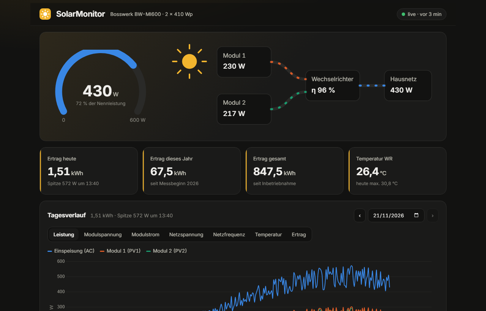
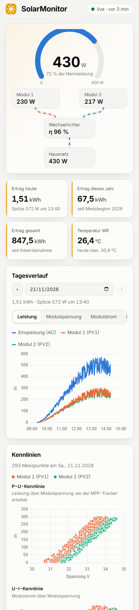
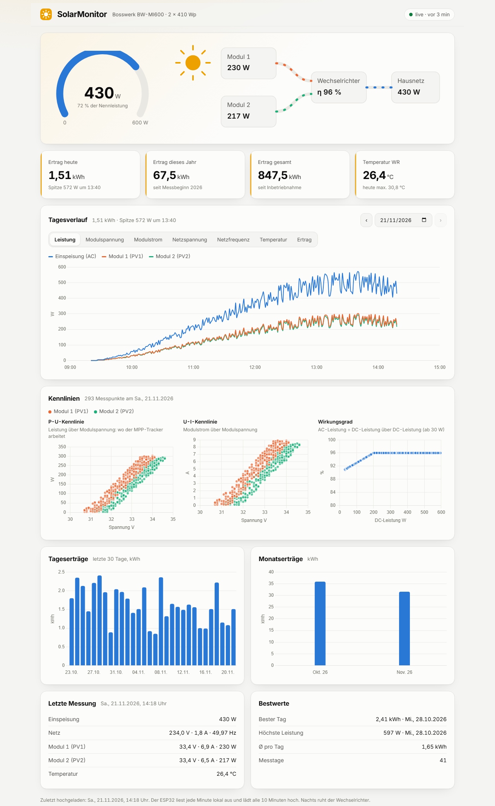
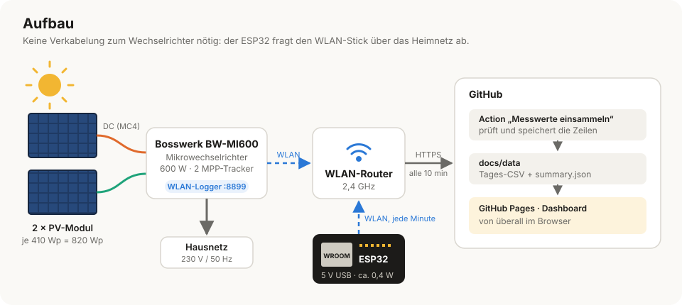

<h1 align="center">☀️ SolarMonitor</h1>

<p align="center">
  Rund-um-die-Uhr-Monitoring für ein Balkonkraftwerk mit <b>Bosswerk BW-MI600</b> (baugleich Deye SUN600G3) –
  <b>ohne Hersteller-App, ohne Cloud des Herstellers</b>, mit eigenem Dashboard auf GitHub Pages.
</p>

<p align="center">
  <a href="https://wikischwemler-ops.github.io/SolarMonitor/"><b>➜ Live-Dashboard öffnen</b></a>
</p>

<p align="center">
  
</p>

---

## Was es kann

| | |
|---|---|
| ⚡ **Live** | Tacho 0–600 W, animierter Energiefluss Modul 1 / Modul 2 → Wechselrichter → Hausnetz, Wirkungsgrad η |
| 📈 **Tagesverläufe** | Leistung, Modulspannung, Modulstrom, Netzspannung, Netzfrequenz, Temperatur, Ertrag – Tag frei wählbar |
| 🔬 **Kennlinien** | P-U (wo der MPP-Tracker arbeitet), U-I, Wirkungsgrad über DC-Leistung |
| 📊 **Erträge** | Tage, Wochen (KW), Monate und Jahre umschaltbar; diese Woche / dieser Monat / dieses Jahr mit Vorperiode; Bestwerte |
| 📶 **Verbindung** | WLAN-Signal des ESP32, Funksignal des Wechselrichter-Sticks, Antwortzeit des Sticks, Upload-Dauer zu GitHub, verlorene Abfragen – mit Tagesverlauf |
| 📱 **Überall** | Responsiv für Handy, Tablet und Desktop, Hell- und Dunkelmodus |
| 🔋 **Sparsam** | ESP32 mit ca. 0,4 W, nachts Tiefschlaf; GitHub kostenlos (öffentliches Repo) |

<p align="center">
  
  &nbsp;&nbsp;
  
</p>
<p align="center"><sub>Bilder mit Beispieldaten</sub></p>

## Aufbau

<p align="center">
  
</p>

1. Der **WLAN-Stick im Wechselrichter** spricht im Heimnetz das Solarman-V5-Protokoll (TCP-Port 8899).
   Zum Auslesen genügt seine Seriennummer (**„WIFI-Nummer“** auf dem Typenschild), kein Passwort.
2. Der **ESP32** fragt jede Minute die Messwerte ab und puffert sie (bis zu 6 h, falls das Internet weg ist).
3. Alle **10 Minuten** schickt er die gesammelten Zeilen per HTTPS (`repository_dispatch`) an GitHub.
4. Die **GitHub Action** [`ingest.yml`](.github/workflows/ingest.yml) prüft die Werte und schreibt sie nach
   `docs/data/days/JJJJ-MM-TT.csv` (Minutenwerte) und `docs/data/summary.json` (Tageswerte).
5. **GitHub Pages** liefert das Dashboard [`docs/index.html`](docs/index.html) aus.

## Hardware

| Teil | Details | ca. Preis |
|---|---|---|
| 2 × PV-Modul | je 410 Wp, zusammen 820 Wp | vorhanden |
| Wechselrichter | Bosswerk BW-MI600, 600 W AC, 2 MPP-Tracker, eingebauter WLAN-Logger | vorhanden |
| Mikrocontroller | **ESP32-WROOM-32** DevKit (z. B. ESP32-DevKitC) mit USB-Seriell-Chip CP2102 oder CH340 | 5–8 € |
| Stromversorgung | USB-Netzteil 5 V / 1 A und **Datenkabel** (reine Ladekabel funktionieren nicht zum Flashen) | 5 € |
| Netzwerk | WLAN-Router mit 2,4 GHz, in Reichweite von Wechselrichter und ESP32 | vorhanden |

Kein Löten, keine Verbindung zwischen ESP32 und Wechselrichter – beide hängen nur im WLAN.
Der ESP32 kann irgendwo im Haus an einer Steckdose stecken.

**Warum ESP32 statt Raspberry Pi?** Ca. 0,4 W statt 2–3 W, kein SD-Karten-Verschleiß, startet nach
Stromausfall von selbst und braucht keine Updates des Betriebssystems.

## Gemessene Werte

| Spalte | Bedeutung | Register | Faktor |
|---|---|---|---|
| `ts` | Unix-Zeit (UTC) | – | – |
| `p` | Einspeiseleistung AC, W | 86/87 | 0,1 |
| `u`, `i`, `f` | Netzspannung V, Strom A, Frequenz Hz | 73, 76, 79 | 0,1 / 0,1 / 0,01 |
| `t` | Temperatur Wechselrichter °C | 90 | (x − 1000) / 100 |
| `u1`, `i1`, `u2`, `i2` | Modul 1 / Modul 2: Spannung V, Strom A | 109–112 | 0,1 |
| `e_day`, `e_total` | Ertrag heute / gesamt, kWh | 60, 63/64 | 0,1 |
| `rssi` | WLAN-Signal ESP32 → Router, dBm | – | – |
| `ap` | Signal des Hotspots `AP_<WIFI-Nummer>`, den der Stick aussendet, am Ort des ESP32, dBm (leer = nicht gefunden) | – | – |
| `lat` | Antwortzeit des Sticks auf die Abfrage, ms | – | – |

Holding-Register, Modbus-Slave 1, Funktion 3; gelesen wird der Block 59–112 in einer Anfrage.
Zusätzlich schickt der ESP32 bei jedem Upload die Dauer des vorigen Uploads und die Zahl der fehlgeschlagenen Abfragen.
Die Werte erscheinen alle 10 Minuten im Dashboard; sekundengenau zeigt sie die Status-Seite des ESP32 im Heimnetz.

## Einrichtung

### 1. Feste IP für den Wechselrichter
Im Router dem WLAN-Stick (aktuell `192.168.0.155`) eine feste IP zuweisen.

### 2. GitHub-Token
GitHub → Settings → Developer settings → **Fine-grained personal access tokens** → *Generate new token*:
- Repository access: **Only select repositories → SolarMonitor**
- Permissions: **Contents: Read and write** (sonst nichts)
- Ablauf: z. B. 1 Jahr (Erinnerung setzen! Danach neu flashen bzw. per OTA aktualisieren)

### 3. Firmware flashen
Benötigt [PlatformIO](https://platformio.org/) (VS Code-Erweiterung oder `pip install platformio`).
Unter Windows in **PowerShell** bauen, nicht in Git Bash.

```powershell
cd firmware
copy include\secrets.example.h include\secrets.h   # ausfüllen: WLAN, LOGGER_SN, GH_TOKEN, OTA_PASS
pio run -e esp32dev -t upload                        # ESP32 per USB angeschlossen
pio device monitor                                   # Log ansehen
```

`secrets.h` steht in `.gitignore` und wird nie committet. Fehlen Seriennummer oder Token, bricht der Build mit
einem Hinweis ab.

Spätere Updates per WLAN: `$env:SOLAR_OTA_PASS="..."; pio run -e ota -t upload`

### 4. GitHub Pages
Repo → Settings → Pages → *Deploy from a branch* → `main` / `/docs`.

## Betrieb

- Lokaler Status des ESP32: `http://solarmonitor.local/` (JSON: letzte Messung, Puffer, letzter Upload).
- Erster Upload ca. 3 min nach dem Einschalten, danach alle 10 Minuten.
- Nachts schaltet sich der WLAN-Stick des Wechselrichters ab. Der ESP32 erkennt das nach 15 min, lädt den
  Rest hoch und schläft 30 min, dann prüft er erneut.
- Ohne ESP32 (Test oder Ersatz):
  `python tools/pc_collector.py --sn <WIFI-Nummer> --count 5 --interval 60 --dispatch wikischwemler-ops/SolarMonitor`
  (Token in `GH_TOKEN`).
- Testzeilen ohne Hardware: Actions → *Messwerte einsammeln* → *Run workflow*.

## Projektstruktur

```
firmware/            ESP32-Firmware (PlatformIO, Arduino)
  src/main.cpp       Abfrage, Puffer, Upload, Nachtschlaf, OTA, Status-Seite
  include/           Root-Zertifikate, secrets.example.h
tools/ingest.py      Prüft Messzeilen und schreibt docs/data (läuft in der Action)
tools/pc_collector.py  Test-/Ersatz-Collector für den PC
docs/                Dashboard (GitHub Pages) und Messdaten
.github/workflows/   Action „Messwerte einsammeln“
```

Die Daten-Commits macht die Action direkt auf `main` (automatische Messwerte).
Code-Änderungen laufen über Pull Requests mit Branch-Namen `xxx/yyy` (siehe `docs/branch-naming-setup.md`).
